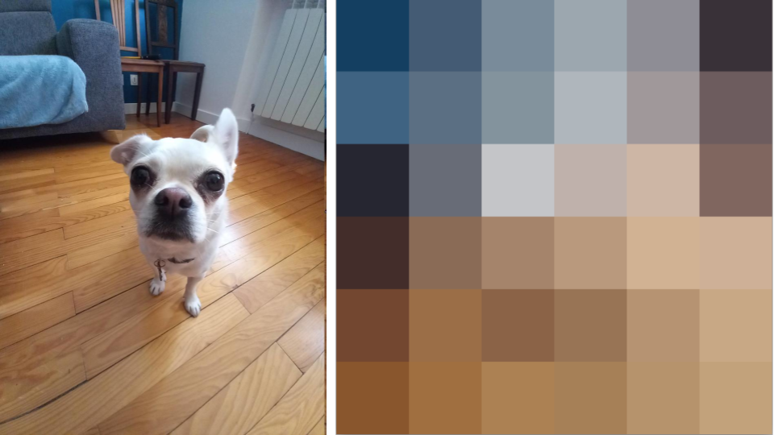

# KSOM - Simple, but relatively efficient, pytorch-based self organising map

This is a simple implementation of self-organising map training in python, using pytorch for efficiency. This enables to create, train and apply maps of potentially high dimensions on CPU or GPU.

Three model classes are provided:
- **SOM**: standard self-organising map
- **WSOM**: weighted SOM with learnable per-feature weights, optimised through a combination of distance-based and entropy-based sparsity loss
- **MCWSOM**: multi-channel weighted SOM, creating multiple WSOM channels with a diversity loss that pushes each channel toward different feature weightings

To install, use
```
pip install ksom
```

Maps are created with a number of rows and columns (`SOM(xs, ys, dim)`), which don't have to be equal. All the classes, distance functions and neighbourhood functions can be imported directly from `ksom`.

## SOM Example

An example is available in ``tests/test_img.py`` for a simple use case creating a square color map of an image. Having loaded the data in a tensor x, the code to initialise and train the SOM looks like this:

```python
from ksom import SOM, cosine_distance, nb_gaussian
...
smodel = SOM(6, 6, 3, # size of the map and dimension of units
             sample_init=samples, # initialised with samples
             dist=cosine_distance, # using cosine distance for BMU
             alpha_init=0.01, # learning rate
             alpha_drate=1e-7, # decay of learning rate
             neighborhood_fct=nb_gaussian, # neighbourhood function
             neighborhood_init=som_size, # initial neighbourhood radius
             neighborhood_drate=0.0001) # decay of neighbourhood radius

perm = torch.randperm(x.size(0)) # to shuffle the data
for i in range(int(x.size()[0]/1000)):
    idx = perm[i*1000:(i+1)*1000]
    time1 = time.time()
    dist,count = smodel.add(x[idx]) # feed the SOM a batch of 1000 pixels
    print(f"{(i+1):06d}K - {dist:.4f} - {(time.time()-time1)*1000:05.2f}ms")
```

The learning rate and the neighbourhood radius decay for every data point, so their decay rates should be set from the total number of points the map will see: about ``alpha_init / total`` for ``alpha_drate`` and ``(neighborhood_init - final_radius) / total`` for ``neighborhood_drate``. If the rates are too small for the amount of data, the radius barely shrinks and much of the map goes unused.

The results on the image on the left looks like the map on the right, where each unit is represented by the colour corresponding to its weights.




Another example is included in the ``tests/test_cheese.py`` creating a map of cheeses based on various binary attributes. The results is presented below with on the right the map represented by colours for each unit created through PCA with 3 components for the RGB components of the colour. On the left, a frequency map is given that show how many cheese have each unit for BMU (brighter == more cheese) as well as the name of the attribute most different in this unit compared to the average of the whole dataset.


## WSOM Example

The WSOM (Weighted SOM) learns per-feature importance weights alongside the map. It requires a PyTorch optimizer. See ``tests/test_w_cars.py`` for a full example.

```python
from ksom.ksom import WSOM, cosine_distance
...
smodel = WSOM(5, 5, dim,
              sample_init=samples,
              dist=cosine_distance,
              alpha_init=1e-2, alpha_drate=5e-8,
              sparcity_coeff=1e-2)

optimizer = torch.optim.Adam(smodel.parameters(), lr=1e-2)
smodel.train()
for epoch in range(n_epochs):
    dist, count, loss = smodel.add(batch, optimizer)
```

The sparsity term is the entropy of the normalised feature weights, and ``smodel.effective_features()`` gives roughly how many features carry the weight. Very small values of ``sparcity_coeff`` have little effect, and the value needed for a strong one depends on the data, typically between ``0.1`` and ``1.0``. On data with one-hot encoded columns, the learned weights tend to concentrate on those columns, and most of the map can then go unused, especially with a strong sparsity term. Check how many units are used as best matches when working with such data.

## MCWSOM Example

The MCWSOM (Multi-Channel Weighted SOM) creates multiple WSOM channels, each learning different feature weightings. A diversity loss (cosine similarity between channel weights) encourages complementary views. See ``tests/test_mcw_cars.py`` for a full example.

```python
from ksom.ksom import MCWSOM, cosine_distance
...
smodel = MCWSOM(5, 5, dim,
                sample_init=samples,
                dist=cosine_distance,
                alpha_init=1e-2, alpha_drate=5e-8,
                sparcity_coeff=1e-2,
                n_channels=4,
                channel_sim_loss_coef=0.5)

optimizer = torch.optim.Adam(smodel.parameters(), lr=1e-2)
smodel.train()
for epoch in range(n_epochs):
    dist, count, total_loss, diversity_loss = smodel.add(batch, optimizer)
```

``channel_sim_loss_coef`` controls how different the channels become: with small values such as ``1e-2``, they stay fairly similar. ``smodel.channel_wsoms`` gives access to the individual WSOMs, for example to read their ``weights`` or ``effective_features()``.
